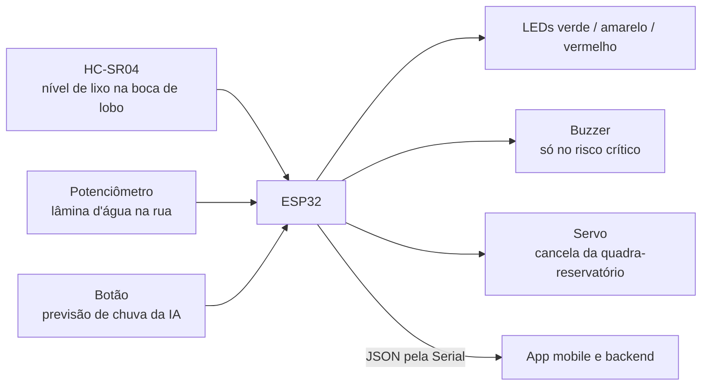

# Quadra Viva — Nó sensor da boca de lobo (Physical Computing: IoT & IoB)

Circuito com **ESP32 simulado no Wokwi** que faz o papel da camada física da CitizenTech *Quadra Viva*: percebe que a boca de lobo está entupida e que a rua começa a encher, classifica o risco e age (alerta e trava a quadra-reservatório). Os níveis de risco e os campos do JSON são os mesmos do app mobile (`mobile/src/data/types.ts`), então o nó e o app falam a mesma língua.

## Ficha da CitizenTech

| Campo | Resposta |
|---|---|
| **Nome da CitizenTech** | Quadra Viva |
| **Cidade e bairro** | São Paulo (SP), Vila Madalena: bairro proposto para o piloto. Os dados são simulados. |
| **Cidadão beneficiado** | Morador de rua com alagamento recorrente e a Defesa Civil local |
| **Problema, em uma frase** | Moradores só descobrem o alagamento depois que a rua já alagou, porque bocas de lobo entupidas não avisam ninguém com antecedência. |
| **Como funciona** | Sensores nas bocas de lobo + previsão de curto prazo + atuadores agem antes da chuva. A quadra pública vira reservatório no pico da chuva. |
| **O que cada parte faz** | **IoT/ESP32 (esta pasta):** mede obstrução e lâmina d'água, classifica o risco e aciona alertas e a cancela da quadra. **Mobile:** mostra o risco por rua ao cidadão. **IA/ML:** previsão de chuva/alagamento. |
| **Link do repositório** | https://github.com/lucasserrano10/GlobalSolution-2026-IOT |
| **Indicador de impacto** | Bocas de lobo desobstruídas antes da chuva; antecedência do alerta; redução da lâmina d'água nas ruas monitoradas. |
| **ODS conectados** | **11** Cidades e comunidades sustentáveis; **13** Ação contra a mudança global do clima; **9** Indústria, inovação e infraestrutura. |

## Como o circuito se encaixa na solução



| Parte do circuito | Componente no Wokwi | Papel na Quadra Viva |
|---|---|---|
| Sensor de obstrução | HC-SR04 no topo da boca de lobo | Distância até o lixo/sedimento. Quanto menor, mais entupida (0–100 %). |
| Sensor de lâmina d'água | Potenciômetro (GPIO34, ADC) | Simula um sensor de nível: 0–30 cm de água na rua. |
| Previsão de chuva | Botão (GPIO4, `INPUT_PULLUP`) | Simula o alerta do modelo de IA ("chuva forte em até 72 h"). |
| Alerta ao morador | 3 LEDs (verde, amarelo, vermelho) | Semáforo do risco, sem depender só de cor: o buzzer reforça o crítico. |
| Alarme | Buzzer (GPIO23) | Intermitente só no nível crítico, para não gerar fadiga de alarme. |
| Quadra-reservatório | Servo (GPIO13) | Cancela que trava o acesso à quadra quando ela vai reter água. |

## Regras de decisão

| Condição | Risco | Saída |
|---|---|---|
| Obstrução < 40 % e lâmina < 3 cm | `baixo` | LED verde |
| Obstrução ≥ 40 % **ou** lâmina ≥ 3 cm | `atencao` | LED amarelo |
| Obstrução ≥ 70 % **ou** lâmina ≥ 8 cm | `alto` | LED vermelho |
| Lâmina ≥ 15 cm **ou** (obstrução ≥ 70 % **e** lâmina ≥ 8 cm) | `critico` | LED vermelho + buzzer |
| Previsão de chuva ligada **e** obstrução ≥ 40 % | sobe para no mínimo `alto` | Age **antes** da chuva |
| Risco `critico`, ou `alto` com chuva prevista | — | Servo em 90° (quadra travada) |

Os limites são **hipóteses de projeto** para a simulação, não normas técnicas. Estão como constantes no topo de [`wokwi/sketch.ino`](wokwi/sketch.ino) para serem calibrados com dados reais.

## Mensagem publicada na Serial

A cada 2 s, uma linha JSON com os mesmos nomes de campos da `Rua` do app:

```json
{"ruaId":"r1","bocaId":"bl-01","risco":"alto","laminaCm":4.2,"obstrucaoPct":75,"bocaObstruida":true,"chuvaPrevista":true,"quadraTravada":true,"sensorOk":true}
```

Linhas que começam com `#` são comentários de diagnóstico. Numa versão física, o mesmo JSON iria por Wi-Fi/MQTT para o backend; no Wokwi a Serial é o canal.

## Como rodar no Wokwi

1. Acesse [wokwi.com](https://wokwi.com), crie um projeto **ESP32** novo e abra a aba `diagram.json`.
2. Substitua o conteúdo de `diagram.json` pelo de [`wokwi/diagram.json`](wokwi/diagram.json).
3. Substitua o código do sketch pelo de [`wokwi/sketch.ino`](wokwi/sketch.ino).
4. Crie/edite `libraries.txt` com o conteúdo de [`wokwi/libraries.txt`](wokwi/libraries.txt) (biblioteca `ESP32Servo`).
5. Clique em **Start the simulation** e abra o monitor serial.

Roteiro de teste (também usado no vídeo):

| Passo | Ação no Wokwi | Resultado esperado |
|---|---|---|
| 1 | Sonar em 60 cm, potenciômetro no mínimo | Verde, cancela aberta, `risco":"baixo"` |
| 2 | Reduzir a distância do sonar para ~30 cm | Obstrução ~50 %: amarelo |
| 3 | Apertar o botão azul (chuva prevista) | Sobe para vermelho e a cancela trava: ação **antes** da chuva |
| 4 | Reduzir o sonar para ~15 cm | Obstrução 75 %: vermelho |
| 5 | Girar o potenciômetro até ~50 % | Lâmina ≥ 15 cm: crítico, buzzer intermitente |
| 6 | Apertar o botão de novo e voltar sonar/potenciômetro | Volta ao verde, cancela abre |

## Validação feita

- O sketch foi compilado com `arduino-cli` (core `esp32:esp32` 3.3.13, placa `esp32:esp32:esp32`) sem erros nem avisos de compilação, usando 22 % da flash.
- A lógica de decisão foi conferida contra o roteiro de teste acima, passo a passo, e dá os resultados esperados.
- **Pendente:** o `diagram.json` foi escrito à mão e ainda não foi aberto no Wokwi. A equipe deve rodar o roteiro acima no simulador antes de gravar o vídeo e ajustar pinos ou ligações se o Wokwi apontar algum erro.

## Escolhas de projeto

- **Mediana de 5 leituras** no sonar para ignorar respingos e picos.
- **Sem `delay` no laço principal:** o buzzer e os relatórios usam `millis()`, então o botão responde na hora.
- **Debounce** de 50 ms no botão.
- **Falha segura:** se o sonar não responder, `sensorOk` vai a `false` e o nó mantém a última obstrução válida em vez de inventar um valor.
- **Privacidade:** o nó não coleta nenhum dado pessoal, só nível de lixo e de água de um ponto da rua.

## Arquivos

| Arquivo | Para quê |
|---|---|
| [`wokwi/sketch.ino`](wokwi/sketch.ino) | Código do ESP32 |
| [`wokwi/diagram.json`](wokwi/diagram.json) | Circuito do Wokwi |
| [`wokwi/libraries.txt`](wokwi/libraries.txt) | Biblioteca usada |
| [`integrantes.txt`](integrantes.txt) | Nomes dos integrantes (entregável) |

## Entregáveis da disciplina

- [x] **Link do projeto no Wokwi:** https://wokwi.com/projects/481062470026549249
- [x] **Link do vídeo (até 4 min):** https://www.youtube.com/watch?v=-2v2jI3ESn0
- [x] **Arquivo `.txt` com os integrantes:** [`integrantes.txt`](integrantes.txt)

## Integrantes

- Ana Clara, RM 559021
- David Murillo, RM 559078
- Lucas Serrano, RM 555170
- Yasmin Gonçalves, RM 559147
